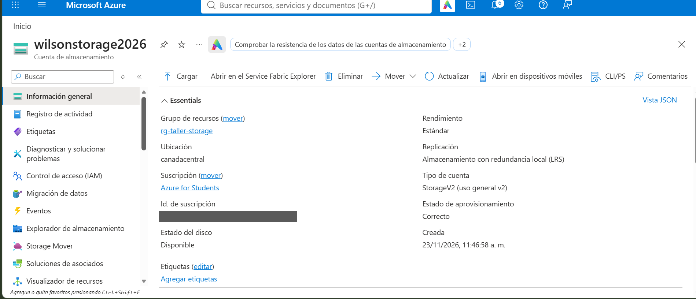
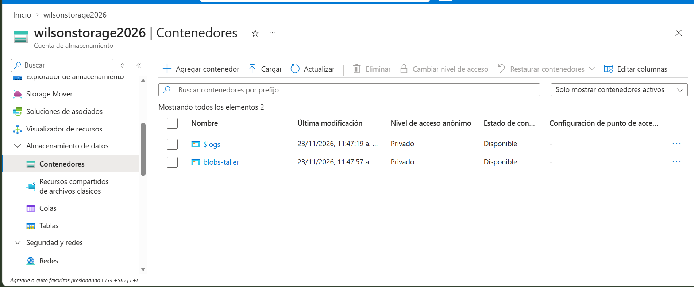
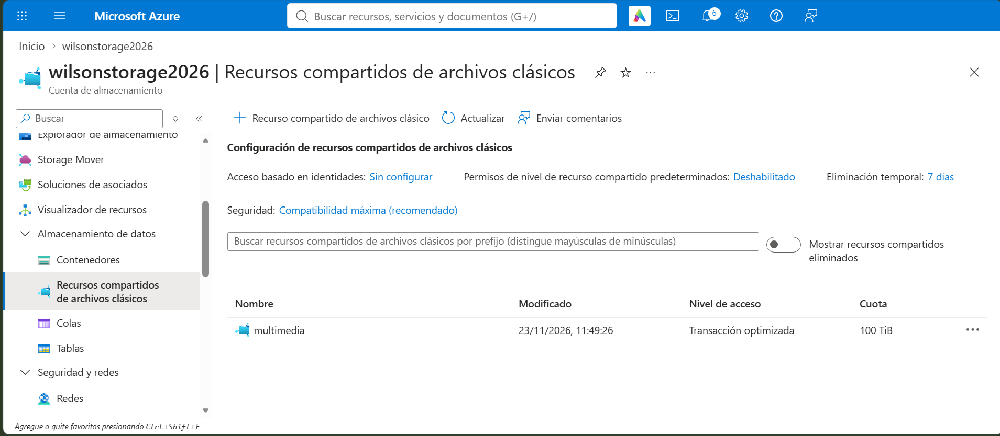
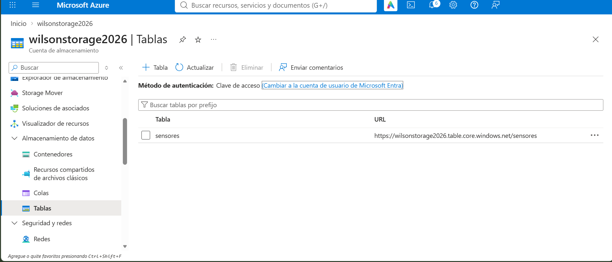
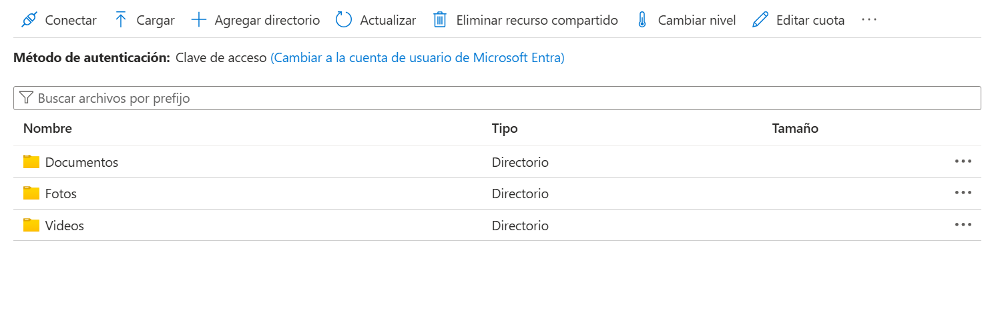
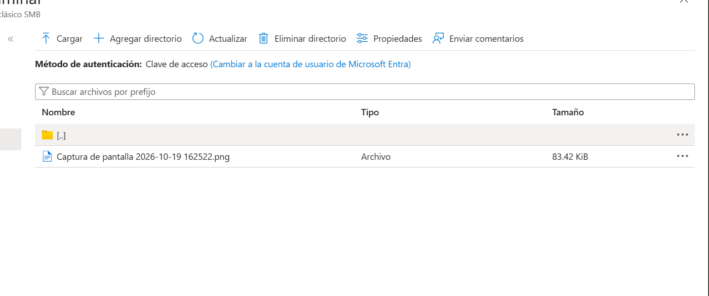
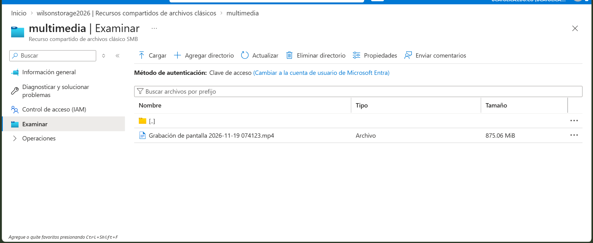
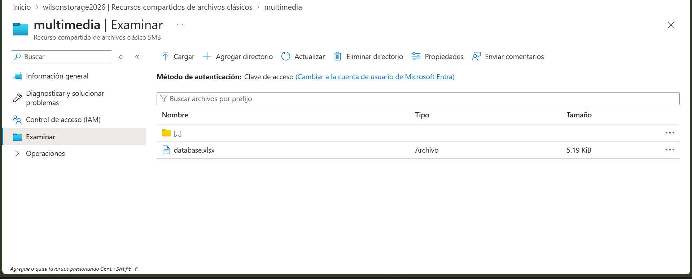
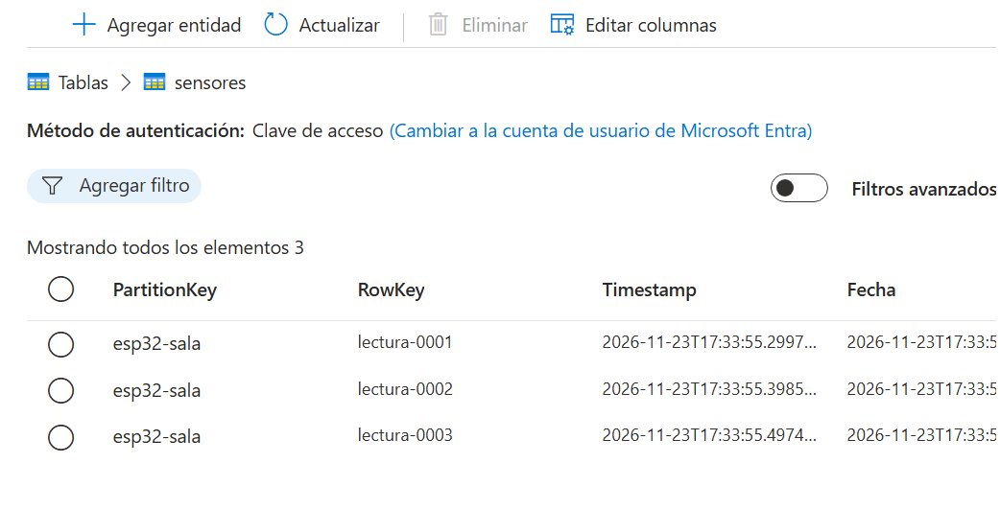
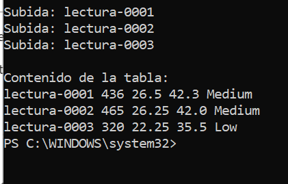

# Taller de Azure Storage

Taller: crear una cuenta de almacenamiento y usar sus 4 servicios: **blobs**,
**archivos**, **tablas** y **colas**. Parte del trabajo se hizo en el portal y
parte con **Python**.

## 1. Cuenta de almacenamiento

| Dato | Valor |
|---|---|
| Nombre | `wilsonstorage2026` |
| Grupo de recursos | `rg-taller-storage` |
| Región | Canada Central |
| Tipo | StorageV2 (uso general v2), rendimiento Estándar |
| Replicación | LRS (almacenamiento con redundancia local) |
| Suscripción | Azure for Students |



## 2. Servicios creados

| Servicio | Nombre | Para qué sirve |
|---|---|---|
| Contenedor de blobs | `blobs-taller` (privado) | Guardar archivos sueltos (imágenes, backups...) |
| Recurso compartido de archivos | `multimedia` | Una "carpeta compartida" en la nube, con subcarpetas |
| Tabla | `sensores` | Datos estructurados en filas (NoSQL clave-valor) |





## 3. Carpetas y archivos en `multimedia`

Dentro del recurso compartido se crearon las carpetas **Fotos**, **Videos** y
**Documentos**, y se subió un archivo de cada tipo.



| Foto | Video | Documento |
|---|---|---|
|  |  |  |

El script [`subir_archivos.py`](subir_archivos.py) hace lo mismo
automáticamente: lee la carpeta local `archivos/`, mira la extensión de cada
archivo (`.jpg`, `.mp4`, `.pdf`...) y lo sube a la carpeta que le corresponde.

## 4. Cargar datos a la tabla con Python

[`cargar_tabla.py`](cargar_tabla.py) guarda 3 lecturas de un **ESP32** (alarma
de incendios: gas, temperatura, humedad y nivel de riesgo) en la tabla `sensores`
y luego las lee para comprobarlo.

Cada fila (entidad) necesita dos claves:
- **PartitionKey** = `esp32-sala`: agrupa las lecturas del mismo dispositivo.
- **RowKey** = `lectura-0001`, `lectura-0002`...: identifica la fila dentro del grupo.

Se usa `upsert_entity` para que, si el programa se corre otra vez, actualice las
filas en vez de dar error por duplicado.




## 5. ¿Qué es el almacenamiento de colas?

Respuesta completa en [`punto5-colas.txt`](punto5-colas.txt). En resumen:
**Azure Queue Storage** guarda mensajes (de hasta 64 KB) para procesarlos
después. Un **productor** los envía y un **consumidor** los lee, los procesa y
los borra. Sirve para comunicar partes de una aplicación sin que dependan una de
otra, para tareas en segundo plano y para aguantar picos de trabajo.

## Cómo ejecutar los scripts (Windows)

```powershell
python -m venv .venv
.\.venv\Scripts\activate
pip install -r requirements.txt

python cargar_tabla.py     # punto 4
python subir_archivos.py   # punto 3 (pon antes los archivos en la carpeta archivos/)
```

La **cadena de conexión** se copia en el portal (cuenta → **Seguridad y redes →
Claves de acceso**). Los scripts la piden al arrancar (`subir_archivos.py`) o la
leen del portapapeles (`cargar_tabla.py`), así **nunca queda escrita en el
código ni se sube a GitHub**.
